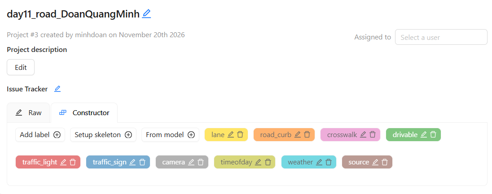
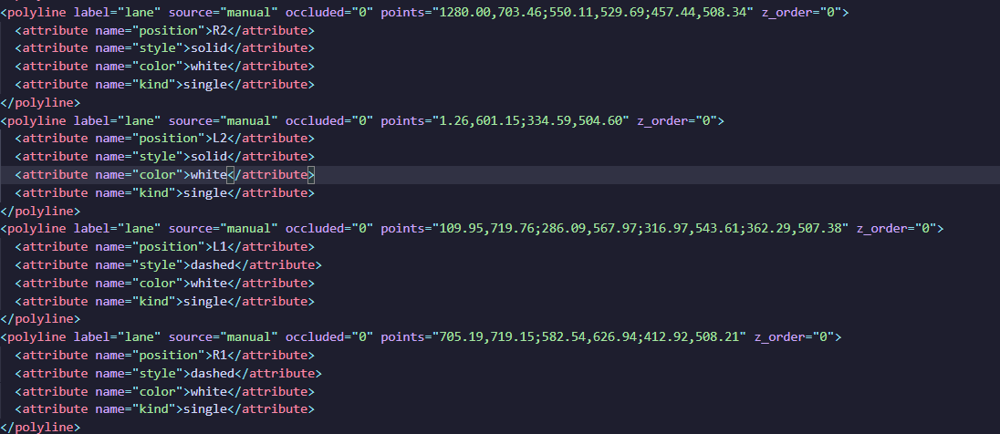

# Báo cáo cá nhân — Ngày 11
Họ tên: Đoàn Quang Minh               Mã học viên: 2A202603228  
Phiên bản CVAT (Help → About): 2.74.1  
Guideline: Road v1.0    Lần nộp (`revision` trong manifest): 1  
Thời điểm export (ngày giờ trên CVAT): 21/11/2026, khoảng 11:13 (giờ Việt Nam; XML ghi 04:13 UTC)    Số lần nộp lại sau Rework: 0  

## 1. Kiểm project
| Mục | Đúng như guideline Road v1.0? | Ghi chú |
| --- | --- | --- |
| 6 label, đúng kiểu | Đúng | lane, road_curb (polyline); crosswalk, drivable (polygon); traffic_light, traffic_sign (rectangle). Đã so với `python -m road_lab.taxonomy` |
| Thuộc tính và giá trị | Đúng | Khối `<meta>` trong file export có đủ thuộc tính và giá trị như bảng ở mục 1 guideline |
| 4 tag ảnh | Đúng | camera, timeofday, weather, source; mỗi tag là label kiểu Tag có một thuộc tính select `value` |

Cách kết thúc polyline trên bản CVAT này: bấm phím **N** sau khi click điểm cuối.  
Cách đặt tag ảnh trên bản CVAT này: chọn công cụ **Tag** ở thanh trái, chọn label rồi bấm **Tag**; sau đó mở **Details** trong bảng Objects để chọn `value`, vì CVAT tự điền giá trị đầu danh sách.

## 2. Số lượng đã gán
| Task | Ảnh | lane | road_curb | crosswalk | drivable | traffic_light | traffic_sign |
| --- | ---: | ---: | ---: | ---: | ---: | ---: | ---: |
| front | 12 | 31 | 12 | 5 | 26 | 41 | 20 |
| front-extra (đã làm 4 / 4) | 4 | 10 | 3 | 5 | 7 | 8 | 10 |
| fisheye | 8 | 2 | 6 | 10 | 10 | 1 | 6 |
| fisheye-extra (đã làm 4 / 4) | 4 | 0 | 1 | 4 | 5 | 0 | 0 |

## 3. Bảng ca khó
| Ảnh | Nhãn | Phân vân giữa | Đã chọn | Lý do |
| --- | --- | --- | --- | --- |
| A05 | lane | vẽ L1/R1 hay không vẽ | không vẽ | Hai bên không có vạch sơn, chỉ có lề (đã vẽ road_curb). Lint báo QC1-02 "chưa có L1/R1"; đây là ảnh không thấy vạch, đề nghị coach xem ảnh để miễn QC1-02 |
| A06, A09, A14 | lane R1 | vẽ R1 hay không vẽ | không vẽ R1 | Bên phải làn không có vạch sơn, chỉ có mép đường/lề. Vẽ vạch không có thật là QC1-03 (nặng). Lint báo QC1-02 "chưa có R1"; đề nghị coach xem ảnh để miễn |
| B11 | lane | vạch vàng/trắng trong bãi đỗ là lane hay vạch ô đỗ | không gán lane | Ảnh camera sau chụp bãi đỗ: viền ô đỗ người khuyết tật, vạch chia ô và vùng kẻ sọc. Guideline mục 4: "Vạch ô đỗ không gán lane" |
| B11 | drivable | gồm ô đỗ hay chỉ lối đi | chỉ lối đi | Guideline: dải đỗ xe không tính vào direct; cắt ở mép cản xe |
| A04, A09 | lane position | vạch thứ ba tính từ làn mình là R2/L2 hay other | other | Road v1.0 chỉ có L1/R1/L2/R2; vạch xa hơn L2/R2 dùng `other` |
| A04, A11, A14 | lane color | white hay yellow | yellow, kind = double | Vạch đôi ở tim đường là vàng (giống QCVN 1.x); ban đầu để mặc định white |
| B03 | traffic_sign edge_zone | bật hay tắt | bật | Tâm hộp (1130, 361) cách tâm ảnh ≈ 505 px, sát ngưỡng 512 px (80 % × 640); lint gợi ý bật, chọn mức an toàn |

## 4. Phiếu QC 1 nhận được
Bạn kiểm lô của tôi: daovungocanh (Đào Vũ Ngọc Ánh)  Quyết định nhận được: Rework  
| Mã lỗi | Số lỗi | Đồng ý? | Đã sửa? |
| --- | ---: | --- | --- |
| QC1-03 (A09, lane x ≈ 523..672 bị cho là phải R1) | 1 | Không | Không sửa: L1 là đúng |
| QC1-02 (A09, thiếu R1, kéo theo lỗi trên) | 1 | Không | Không sửa: bên phải không có vạch sơn |
| QC1-12 (xuất 4 file zip thay vì 2) | 1 | Có | Đã sửa: gộp thành `doanquangminh-front.zip` (16 ảnh) và `doanquangminh-fisheye.zip` (12 ảnh) |

Lý do không đồng ý ở A09: làn xe đang đi là vùng `drivable direct` chứa giữa capô (x ≈ 640). Vạch x ≈ 523..672 nằm **bên trái** làn đó nên là **L1**. Bên phải làn chỉ có lề (đã vẽ `road_curb`), không có vạch sơn, nên ảnh không có R1 (QC1-02 thuộc diện ảnh không thấy vạch, giống A05, A06, A14). Đổi vạch này thành R1 sẽ tạo ra lỗi `position` thật. Hai lỗi nặng này là lý do duy nhất của quyết định Rework, nên tôi đề nghị coach xem lại A09. Vì không có thay đổi nhãn nào, lần nộp vẫn là `revision 1`.

## 5. Kiểm file export
| File | Mở lại được? | Số shape ảnh 1 (job / file) | Số shape ảnh 2 (job / file) | Tag camera có trong XML? |
| --- | --- | --- | --- | --- |
| doanquangminh-front.zip | Có (`road_check lint` đọc đủ 16 ảnh, 16/16 ảnh đủ 4 tag) | A01: 9 / 9 | A02: 7 / 7 | Có (`<tag label="camera">`, value = front) |
| doanquangminh-fisheye.zip | Có (`road_check lint` đọc đủ 12 ảnh, 12/12 ảnh đủ 4 tag) | B01: 2 / 2 | B02: 4 / 4 | Có (value = fisheye_front / rear / left / right theo hậu tố file) |

Manifest `doanquangminh-manifest.json`: `revision 1`, `contains_images: false` ở cả hai file; lint lúc tạo: nặng 5 (đều là QC1-02 ở A05, A06, A09, A14, xem mục 3), chính 0, nhẹ 0.  
Ghi chú: CVAT export riêng từng task, nên `front` + `front-extra` và `fisheye` + `fisheye-extra` được gộp thành một `annotations.xml` cho mỗi file nộp.

## 6. Ảnh chụp màn hình
1. Tab Labels của project.

   

2. Một ảnh camera trước đã gán đủ (làn, vùng lái, đèn/biển).

   Ảnh chụp có chứa ảnh BDD100K nên không đưa lên GitHub (dữ liệu lớp không được phân phối lại, xem `ATTRIBUTION.md`). Ảnh `2-front.png` gửi riêng cho coach.

3. Một ảnh fisheye đã gán, phóng to đoạn polyline cong.

   Ảnh chụp có chứa ảnh WoodScape nên không đưa lên GitHub (điều khoản WoodScape không cho phân phối lại, xem `ATTRIBUTION.md`). Ảnh `3-fisheye.png` gửi riêng cho coach.

4. Một đoạn XML có `<polyline label="lane">`.

   

## 7. Tự đánh giá
Lỗi bạn mắc nhiều nhất hôm nay (theo mã QC1-xx), và cách tránh ở Ngày 20:  
QC1-08 / QC1-09: lần export đầu, toàn bộ 66 hộp đèn để mặc định `red · vehicle · front` và 32 biển để `prohibitory · front`, vì CVAT tự điền giá trị đầu danh sách và tôi chưa mở Details. Tiếp theo là QC1-01 (A12, B07, B09 thiếu tag; B04, B06, B12 sai tag camera) và QC1-06 (vạch vàng đôi để màu white). Ở Ngày 20, tôi sẽ sửa thuộc tính ngay sau khi vẽ mỗi hình, đặt tag camera theo hậu tố file trước tiên, và chạy `road_check lint` sau mỗi task chứ không đợi tới cuối buổi.

Nhãn của bạn đi vào model ở đâu? Chọn một lỗi đã sửa và nói nó làm model học sai thế nào:  
Hộp `traffic_light` cùng thuộc tính `color` là dữ liệu huấn luyện cho bộ nhận diện và phân loại trạng thái đèn. Nếu giữ lỗi "mọi đèn đều red", model sẽ học rằng đèn xanh cũng là đèn đỏ. Khi chạy thật, xe có thể phanh vô cớ ở đèn xanh. Tệ hơn, lớp "red" bị lẫn mẫu xanh nên ranh giới giữa hai lớp mờ đi, và model có thể nhận nhầm đèn đỏ thành xanh. Lỗi này nằm trên đèn `facing = front`, đúng loại mà thang QC xếp mức nặng.

## 8. (Tùy chọn, buffer) Từ polyline đến đích row-anchor
| y | 720 | 680 | 640 | 600 | 560 |
| --- | ---: | ---: | ---: | ---: | ---: |
| x của chúng tôi |  |  |  |  |  |
| x của bạn kia |  |  |  |  |  |

Trả lời 3 câu:

1. Năm số x đó chính là đích mà một model row-anchor học cho vạch này. Nếu bạn dừng polyline sớm 40 px, hàng nào đổi thành "không có làn"?
2. So với bạn được kiểm (cùng ảnh): ở hàng 720 và hàng 560, hai bạn lệch nhau bao nhiêu pixel? Lệch ở hàng nào ảnh hưởng LKA nhiều hơn (slide 25)?
3. Nếu polyline vẽ từ xa về gần (ngược quy tắc 2), cách tính trên có đổi không? Script nào sẽ gặp khó?
